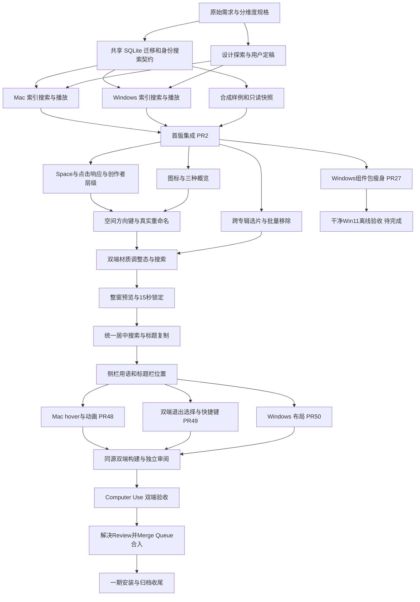
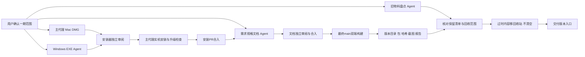

# 一期并行分工与任务 DAG

记录一期实际工作包与交付依赖，供其他 Agent 审阅分工规则。本文件是过程复盘，协作要求仍以 [GitHub Flow](../workflow/git.md)和 [SDD](../workflow/sdd.md)为准。

## 拆分思路与实际分派

| 工作包 | 主责与并行方式 | 产出与合流 |
| --- | --- | --- |
| 原始范围、共享契约 | 主代理先登记需求、SQLite 迁移、命名与搜索契约；平台与样例 Agent 据此接入 | [首版 #2](https://github.com/AMindFlow/iPreview/pull/2)、[全范围 #4](https://github.com/AMindFlow/iPreview/pull/4)。最初 Mac、Windows、样例在独立 worktree 开发，统一集成到一个首版 PR。 |
| 首版体验五项 | 点击响应、Space 切换、创作者层级、图标分别拆包；三视图接入既有选择与预览契约 | [#10](https://github.com/AMindFlow/iPreview/pull/10)、[#11](https://github.com/AMindFlow/iPreview/pull/11)、[#12](https://github.com/AMindFlow/iPreview/pull/12)、[#13](https://github.com/AMindFlow/iPreview/pull/13)、[#14](https://github.com/AMindFlow/iPreview/pull/14)。Windows 计时诊断 [#15](https://github.com/AMindFlow/iPreview/pull/15)仅作 QA，未并入产品。 |
| 空间导航与图标定稿 | 键盘导航／真实列数与 SVG 图标可以独立；合成网格统一边界样例 | [#19](https://github.com/AMindFlow/iPreview/pull/19)、[#20](https://github.com/AMindFlow/iPreview/pull/20)。 |
| 重命名与跨专辑选片 | 共享路径身份／恢复契约先于双端文件操作；选片器另一路；视觉按用户选定底部胶片条完善 | [#24](https://github.com/AMindFlow/iPreview/pull/24)、[#23](https://github.com/AMindFlow/iPreview/pull/23)。分别有平台实现 worktree，再归入对应功能 PR。 |
| 引用批量移除与独立瘦身 | 合集操作和发布依赖可独立并行；后者因干净离线环境验收未完成而不随其他功能合流 | [#28](https://github.com/AMindFlow/iPreview/pull/28)已合入；[#27](https://github.com/AMindFlow/iPreview/pull/27)仍草稿，结果保留在后续待验收台账。 |
| 原生材质、调整、改名、搜索 | Mac 与 Windows 分平台实现；行为规格共同维护，合成媒体、目录及引用用于交叉验收 | Mac [#30](https://github.com/AMindFlow/iPreview/pull/30)、修正 [#33](https://github.com/AMindFlow/iPreview/pull/33)，Windows 对应 [#34](https://github.com/AMindFlow/iPreview/pull/34)。 |
| 双端预览控制 | Mac 预览、Windows 预览／搜索、Windows 视觉拆成 worktree，因同一键盘与预览顶栏契约在 [#36](https://github.com/AMindFlow/iPreview/pull/36)合流 | 整窗遮挡、锁定、15秒、搜索快捷键及 Windows 材质共同实机验收。 |
| 搜索与复制 | 文件名复制可独立审阅；搜索双端实现并行，共同键位与精确模式契约后统一验收 | 复制 [#39](https://github.com/AMindFlow/iPreview/pull/39)，统一搜索 [#40](https://github.com/AMindFlow/iPreview/pull/40)。 |
| 侧栏与用语 | Mac 与 Windows 在不同 worktree 对齐入口和文案；Mac 标题栏位置独立修正 | [#42](https://github.com/AMindFlow/iPreview/pull/42)、[#44](https://github.com/AMindFlow/iPreview/pull/44)。 |
| 最后一轮体验对齐 | `mac_hover_animation` 负责 Mac hover／动画／玻璃切换器；`selection_shortcuts` 负责两端退出选择与快捷键；`windows_layout` 负责 Windows 布局、标题栏输入区域和网格列数。各独立 worktree／分支／PR | [#48](https://github.com/AMindFlow/iPreview/pull/48)、[#49](https://github.com/AMindFlow/iPreview/pull/49)、[#50](https://github.com/AMindFlow/iPreview/pull/50)；审阅交叉分派，主代理串行操作两个实机并统一包、哈希与截图。 |
| 一期收尾 | 主代理承担 Mac DMG、双端实机、集成与发布；子 Agent 分别承担 Windows EXE 安装器、需求台账、存储盘点兼独立审阅。安装实现与文档／盘点并行。安装先合入，文档再与其对齐 | [收尾 #51](https://github.com/AMindFlow/iPreview/issues/51)。先安装验收，再冻结最终 main 物料，最后回收旧 worktree／包／验证材料。 |

## 一期功能依赖

图中的合流节点只表示验收依赖；同一功能内部的 Mac／Windows 实现并行，不要求整图各条串行。瘦身分支没有接到一期发布，防止未完成验收阻塞已接受的功能交付，或被误当已发布。

## 收尾依赖与角色

## 可供后续审阅的分工结论

- 共享数据身份、搜索语义和快捷键先定，平台实现与合成样例随后并行；同一规格文件由一个负责人整合，减少平台分支互相覆盖口径。
- 初版以一个集成 PR 交付，后续按可独立验收行为拆为多个 PR。平台差异大时可拆平台 PR，最终发布仍汇总同源包，避免只在一端完成而误报双端完成。
- 规格与设计产出、产品实现、独立审阅、实机验收是不同责任。审阅当前提交；实机使用当前包；rebase 或修正后按受影响行为更新证据，不能拿旧 SHA 的 PASS 代替。
- 两台交互桌面的焦点与 RDP 键盘由主代理串行控制。构建、文档、源码审阅和盘点可并行，多个 Agent 不同时操作同一桌面。此项是一期实际瓶颈，可评估独立桌面会话以缩短等待。
- 安装与发布会改变最终内容及版本物料，因此先做安装器，再冻结文档和最终构建，最后清理。未验收的独立工作包维持自己的 Issue／PR，不为「一期收尾」强行标完成。
- 版本目录保留最终包和必要证据，临时 worktree／阶段包不作为长期文档入口；源码与 PR 保存实现过程，报告只写当前结果和剩余边界。
