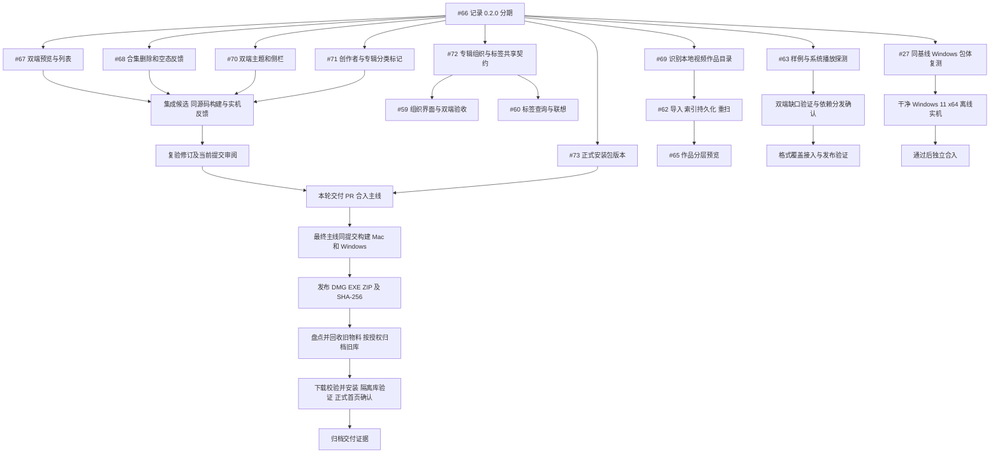

# 二期并行分工与任务 DAG

本复盘记录 0.2.0 本轮验收候选的分工、合流和验证证据。各工作包的产品要求由对应规格及 Issue 维护，正式发布以最终提交的发布记录为准。[0.2.0 总任务 #58](https://github.com/AMindFlow/iPreview/issues/58) · [分期计划 PR #66](https://github.com/AMindFlow/iPreview/pull/66)

## 实际工作包

| 工作包 | 并行与合流 | 交付证据 |
| --- | --- | --- |
| 预览和列表 | macOS 与 Windows 预览实现分开推进，再统一复制反馈、退出选中和连续切换契约。后续验收反馈补入列表默认值、视图按钮顺序和列表焦点滚动。 | [#57](https://github.com/AMindFlow/iPreview/issues/57) · [PR #67](https://github.com/AMindFlow/iPreview/pull/67) |
| 合集 | 同一工作包实现双端删除确认及引用保护。空合集图标及悬停、按下反馈沿用同一选片入口，随合集交互一起复验。 | [#61](https://github.com/AMindFlow/iPreview/issues/61) · [PR #68](https://github.com/AMindFlow/iPreview/pull/68) |
| 主题与侧栏 | 两端使用各自的原生控件与偏好保存方式。候选安装后逐次核对图标、命中区域和主题提示。 | [#64](https://github.com/AMindFlow/iPreview/issues/64) · [PR #70](https://github.com/AMindFlow/iPreview/pull/70) |
| 搜索分类标记 | 创作者与专辑的类别、图标和路径提示独立接入双端搜索，可在标签契约推进期间验收。 | [#60](https://github.com/AMindFlow/iPreview/issues/60) · [PR #71](https://github.com/AMindFlow/iPreview/pull/71) |
| 集成与验证 | 独立 worktree 和 PR 保存各功能改动，验收分支合成同一源码的双端安装包。按候选版本记录反馈并更新证据，两台实机分别使用合成样例与隔离库。 | [preview.6 双端构建](https://github.com/AMindFlow/iPreview/actions/runs/45169778692) |
| 正式安装包 | 独立设置 macOS ARM64 与 Windows x64 的 0.2.0 版本。包体按当前主线自包含基线生成。 | [PR #73](https://github.com/AMindFlow/iPreview/pull/73) · [正式发布记录](https://github.com/AMindFlow/iPreview/releases/tag/v0.2.0) |

`0.2.0-preview.6` 的集成提交为 `4c9d95041addac8ea12a02b1bddb2a1958342ebf`。macOS CoreChecks、DMG 构建、macOS 15 上从应用 ZIP 解压启动、Windows CoreChecks 和每用户安装器检查均通过。候选安装记录显示，Mac 从「应用程序」启动并读取已有资料库，Windows 从开始菜单启动且 522 个安装文件逐一匹配构建产物。Windows 还核对了主题菜单、深色重启恢复、空合集删除的取消和确认，以及用 Layout-Root 搜索分类和跳转。短暂按下反馈与 macOS 的悬停、Option 菜单保留人工核验范围。[构建及检查结果](https://github.com/AMindFlow/iPreview/actions/runs/45169778692)

## 继续推进的工作

- **预览持续切换。** 补齐双端三种布局的真实长按、逐帧画面连续性与坏图导航。[#57](https://github.com/AMindFlow/iPreview/issues/57) · [拟改 PRE-008](../specs/spike/preview.md#pre-008-长按方向键连续切换)
- **专辑组织和标签搜索。** 共享 SQLite 契约与双端目录接口已形成可审阅提交，完成界面接入后验收标签、评分、收藏与封面。标签查询与联想复用同一标签身份和规范化接口，接续已独立完成的分类标记。[#59](https://github.com/AMindFlow/iPreview/issues/59) · [#60](https://github.com/AMindFlow/iPreview/issues/60) · [PR #72](https://github.com/AMindFlow/iPreview/pull/72)
- **视频作品与预览。** 已实现完整和简化目录的本地只读识别及合成样例，先接入导入、索引持久化和重扫，再接入作品级分层预览。[#62](https://github.com/AMindFlow/iPreview/issues/62) · [#65](https://github.com/AMindFlow/iPreview/issues/65) · [PR #69](https://github.com/AMindFlow/iPreview/pull/69)
- **常见视频格式。** 合成样例已在 macOS 系统播放器路径查出 MKV、WebM 和 AVI 的缺口。Windows 同组探测、应用内播放验证以及新增依赖的许可与分发方案仍待完成。[#63](https://github.com/AMindFlow/iPreview/issues/63)
- **Windows 包体。** 同基线复测显示 WinUI 组件候选 ZIP 缩小 26.96%，解压后应用文件字节数缩小 26.51%。独立 PR 等待干净 Windows 11 x64 离线实机验收。[#26](https://github.com/AMindFlow/iPreview/issues/26) · [PR #27](https://github.com/AMindFlow/iPreview/pull/27) · [同基线复测](https://github.com/AMindFlow/iPreview/actions/runs/45026806736)

## 开发和交付依赖

验收分支保留候选组成与反馈。本次正式交付按最终主线的同一提交构建并发布，依据回收清单处理旧安装和过时测试物料，按授权归档旧应用资料库。再从发布记录下载校验、安装，分别验证正常入口的正式首页与隔离 QA 库。合成样例仅导入 QA 库。覆盖升级和卸载沿用资料库保留契约。[版本发布流程](../workflow/release.md) · [双端验收步骤](acceptance.md)

清理按最终包、当前证据和后续开发逐项核对依赖。交付包、校验值、复用样例、独立瘦身和格式探测证据保留在相应位置。实际回收对象、正式安装结果与验收证据以 [v0.2.0 发布记录](https://github.com/AMindFlow/iPreview/releases/tag/v0.2.0)为准。
