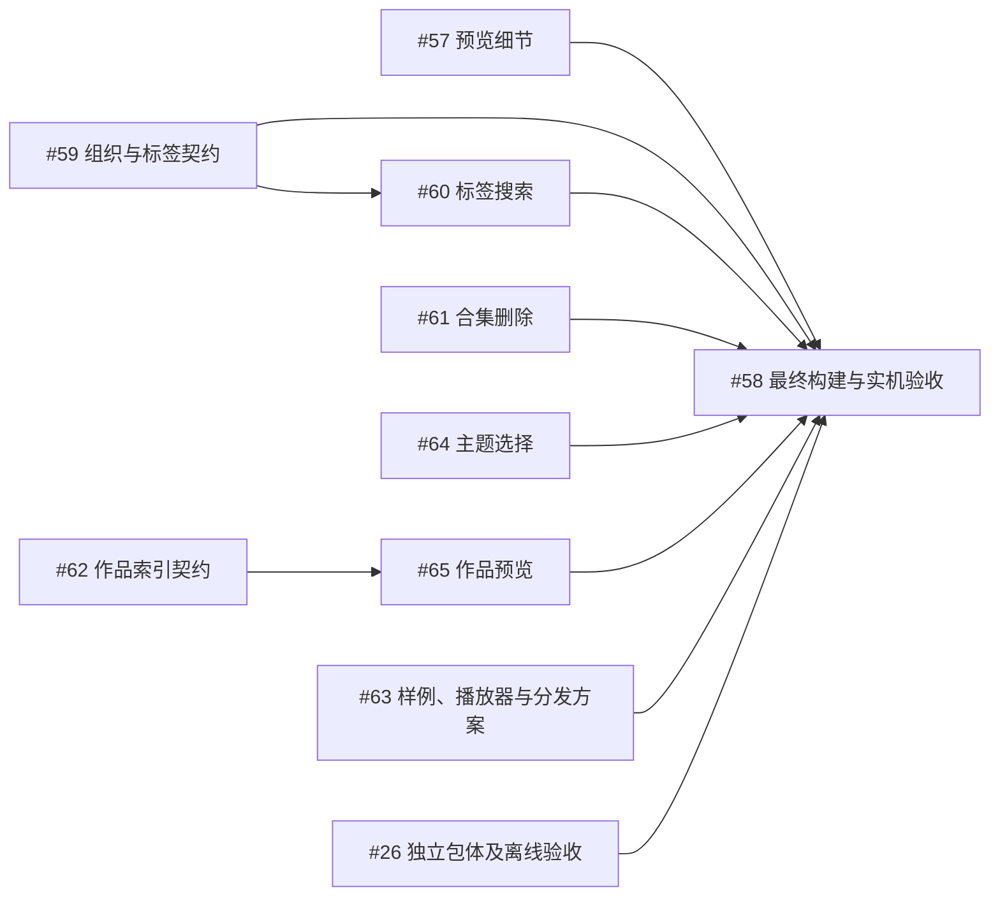

# iPreview 0.2.0 开发计划

[版本总任务 #58](https://github.com/AMindFlow/iPreview/issues/58)与 [0.2.0 里程碑](https://github.com/AMindFlow/iPreview/milestone/1)跟踪本期实施及验收。本期承接 #57、#26 和首版 #1 延续的指定规格。产品行为及单项验收以各维度规格为准。

## 工作包

| Issue | 范围 | 前置 |
| --- | --- | --- |
| [#57](https://github.com/AMindFlow/iPreview/issues/57) | [PRE-007、008、010](../../specs/spike/preview.md#pre-007-退出预览时同步选择)，复制文件名成功反馈、退出预览选择同步、长按切换黑闪 | 可并行 |
| [#59](https://github.com/AMindFlow/iPreview/issues/59) | [ALB-002](../../specs/spike/virtual-albums.md#alb-002-旧版标签收藏评分与封面)，标签与筛选、收藏、半星评分、封面 | 先定共享组织及标签契约 |
| [#61](https://github.com/AMindFlow/iPreview/issues/61) | [ALB-003](../../specs/official/virtual-albums.md#alb-003-合集删除)，合集删除 | 可并行 |
| [#60](https://github.com/AMindFlow/iPreview/issues/60) | [SRCH-003](../../specs/spike/search.md#srch-003-旧版分类结果与标签搜索)，创作者与专辑分类结果、标签搜索与联想 | 分类结果可并行，标签查询依赖 ALB-002 标签契约 |
| [#64](https://github.com/AMindFlow/iPreview/issues/64) | [UI-007](../../specs/spike/appearance.md#ui-007-主题选择与恢复)，主题选择与恢复 | 可并行 |
| [#62](https://github.com/AMindFlow/iPreview/issues/62) | [LIB-006](../../specs/spike/library.md#lib-006-两种视频作品结构)，完整与简化作品目录、本地样张和写真集 | 先定共享作品索引契约。外部样张来源及获取方式待确认 |
| [#65](https://github.com/AMindFlow/iPreview/issues/65) | [PRE-004](../../specs/spike/preview.md#pre-004-视频作品的影碟与图册预览)，作品影碟和图册分层预览 | 依赖 LIB-006 作品索引契约 |
| [#63](https://github.com/AMindFlow/iPreview/issues/63) | [PRE-006](../../specs/spike/preview.md#pre-006-常见视频格式扩展)，视频格式覆盖与播放验证 | 先验证系统框架播放缺口，生产依赖与分发方案经确认后接入 |
| [#26](https://github.com/AMindFlow/iPreview/issues/26) | [PLAT-004](../../specs/spike/platforms.md#plat-004-windows-组件包瘦身)，Windows x64 自包含 ZIP 瘦身 | [独立 PR #27](https://github.com/AMindFlow/iPreview/pull/27)同步主线后重跑同基线对照和干净 Windows 11 x64 离线验收，通过后合入 |

## 开发依赖

各任务按 [GitHub Flow](../../workflow/git.md)拆分 worktree、分支和 PR。ALB-002 与 LIB-006 的共享库改动按 [SQLite 契约](../../../shared/README.md)协调迁移顺序。新增外部服务、网络调用或随包生产依赖前取得用户同意。

## 发布验收

- 基于同一最终提交生成 macOS ARM64 DMG／应用 ZIP、Windows 11 x64 EXE／自包含 ZIP，登记提交、SHA-256、系统版本、样例与验收结果。
- 双端用相同合成来源和隔离 QA 库验收本期工作包，回归 [0.1.0 关键路径](../acceptance.md)。从非空 0.1.0 QA 库升级，验证索引、合集引用及排序、重扫和离线恢复。比对源文件快照。
- 在干净 Windows 11 x64 离线验证最终自包含 ZIP，记录预装运行时、断网证据和最终包体积。若新增播放底座，随最终包验证额外格式的索引、搜索、播放及分发依赖。
