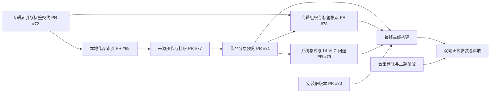

# iPreview 0.3.0 发布与验收登记

本期承接[功能细节优化 #75](https://github.com/AMindFlow/iPreview/issues/75)和[首版 #1](https://github.com/AMindFlow/iPreview/issues/1)中指定的专辑组织、搜索、视频作品与格式需求。任务汇总在 [0.3.0 里程碑](https://github.com/AMindFlow/iPreview/milestone/2)。

## 工作包与合入状态

以下状态核对于 2026-11-24。正式发布以最终主线构建和双端安装验收为准。

| 工作包 | 状态与追踪 | 本期行为和验收入口 |
| --- | --- | --- |
| 来源操作 LIB-013 | 已合入 [PR #77](https://github.com/AMindFlow/iPreview/pull/77) 与 [#75](https://github.com/AMindFlow/iPreview/issues/75) | 「源」右侧加号添加媒体源。来源行右键或用触摸板左滑可重扫或删除。取消保留原状。确认只移除该源的索引、专辑组织和合集相关引用，保留原文件、其他来源和剩余引用次序。重导同一目录获得新来源和媒体身份。 |
| 文件排序 BRW-004 | 已合入 [PR #77](https://github.com/AMindFlow/iPreview/pull/77) 与 [#75](https://github.com/AMindFlow/iPreview/issues/75) | 图标、列表、画廊、选片器与媒体预览按文件名、修改时间或大小升降序。检查当前选择、预览方向键和选片勾选保持，合集手工顺序继续从「调整」修改。作品图册与专辑封面选片在 [PR #81](https://github.com/AMindFlow/iPreview/pull/81) 和 [PR #78](https://github.com/AMindFlow/iPreview/pull/78) 共用排序。 |
| 专辑组织 ALB-002 | [数据契约 PR #72](https://github.com/AMindFlow/iPreview/pull/72) 已合入，界面见待合入的 [PR #78](https://github.com/AMindFlow/iPreview/pull/78) 与 [#59](https://github.com/AMindFlow/iPreview/issues/59) | 来源专辑的「专辑组织」可设置标签、收藏、未评分与半星评分，以及自动、手选和 2–4 张拼图封面。媒体库可全库改名和删除标签。检查零分区别于未评，重启恢复，配置封面缺失时回退、恢复后保留原拼图次序。 |
| 分类与标签搜索 SRCH-003 | 创作者、专辑的分类标记已随 0.2.0 交付。分组与标签查询见待合入的 [PR #78](https://github.com/AMindFlow/iPreview/pull/78) 与 [#60](https://github.com/AMindFlow/iPreview/issues/60) | 在当前范围和全局搜索核对创作者、专辑、目录、文件分组和组内匹配顺序。用标签菜单或输入 `#` 唤起联想，上下选择、回车应用。验证标签与精确、模糊及文件、目录筛选组合，确认结果可定位原专辑和文件。 |
| 视频作品索引 LIB-006 | [PR #69](https://github.com/AMindFlow/iPreview/pull/69) 已合入，关联 [#62](https://github.com/AMindFlow/iPreview/issues/62) | 导入或重扫完整、简化作品目录，核对主视频、随目录提供的官方样张、写真集及封面。重启、离线和重连保留作品身份与归属，旧来源沿用原布局和已登记媒体 ID。外部样张提供方和获取方式另行确认。 |
| 作品分层预览 PRE-004 | 已合入 [PR #81](https://github.com/AMindFlow/iPreview/pull/81) 与 [#65](https://github.com/AMindFlow/iPreview/issues/65) | 点击「预览作品」或选中作品目录按 Space，进入影碟、官方样张与各册写真集。方向键选项，Space 进入文件层和媒体预览，Esc 逐层返回并恢复选择。从浏览或搜索直接打开单媒体时，Esc 返回原入口。 |
| 常见视频格式 PRE-006 | 见待合入的 [PR #79](https://github.com/AMindFlow/iPreview/pull/79) 与 [#63](https://github.com/AMindFlow/iPreview/issues/63) | 双端索引并按后缀搜索 MP4、MOV、MPEG-TS、MKV、WebM、AVI。优先使用系统播放器，MKV、WebM、AVI 系统播放失败时由随包 LibVLC 3.0.24 回退。验证包内运行时、许可、对应源码及同一画布播放、定位和退出。 |
| 合集删除 ALB-003、主题 UI-007 | 0.2.0 已交付，本期复验。[#61](https://github.com/AMindFlow/iPreview/issues/61) · [#64](https://github.com/AMindFlow/iPreview/issues/64) | 复验合集删除的取消和确认、其他引用顺序及源文件保留。切换跟随系统、浅色、深色并重启验证恢复，覆盖专辑组织、搜索及作品预览。 |
| 安装包版本 | [PR #80](https://github.com/AMindFlow/iPreview/pull/80) 已合入（`e5b0e778`） | macOS 与 Windows 安装包统一为 0.3.0，macOS 构建号 9。安装身份与资料库保留遵循 [PLAT-005](../../specs/official/platforms.md#plat-005-首版标准安装包)。 |

## 候选构建与实测

- 集成提交 `9916b922b9225dbaac891b6e0a7dddcc016ce54b` 通过 macOS ARM64 构建和 CoreChecks、macOS 15 包内启动、Windows x64 构建和安装器验证。运行时许可清单和对应源码随该构建产出。[集成 CI](https://github.com/AMindFlow/iPreview/actions/runs/45212670072)
- macOS 隔离候选已实测三种浏览布局、独立预览与选片排序，验证合集手工顺序。另用同批本地作品样例验证完整与简化结构、图册排序、MP4／MOV 播放及 Esc 逐层返回。[来源和排序验证](https://github.com/AMindFlow/iPreview/pull/77) · [作品预览验证](https://github.com/AMindFlow/iPreview/pull/81)
- Windows 实机复验独立预览排序，倒序后方向按钮按新位置更新，退出选中最后查看的文件。新版排序入口避开系统标题栏按钮。作品的三列写真网格由第 1 项向下到第 4 项，到行末后不跨行，退出保留所选照片。[来源与排序 CI](https://github.com/AMindFlow/iPreview/actions/runs/45217399894) · [作品网格集成 CI](https://github.com/AMindFlow/iPreview/actions/runs/45217813626)
- 专辑组织候选通过旧库升级、离线封面恢复及本地作品专辑互操作检查。macOS 隔离界面核对收藏、标签联想和结果分组。[专辑组织与搜索验证](https://github.com/AMindFlow/iPreview/pull/78)
- MP4、MOV、MPEG-TS 保持系统播放路径。MKV、WebM、AVI 优先尝试系统播放。macOS 隔离候选已实测 FFV1／FLAC Matroska 的应用内回退、暂停、定位、重播和退出。Windows 11 x64 的 `9916b922` 候选在内置预览中显示同一 FFV1／FLAC 样例的画面，进程加载了随包的 `libvlc.dll` 与 `libvlccore.dll`。该样例用系统播放器打开时，音轨和播放位置推进但自然画面尺寸为 0×0，帧探针未收到画面。[格式验证](https://github.com/AMindFlow/iPreview/pull/79)
- 双端 LibVLC 软件回调探针用同一个 56 秒合成样例，各捕获 7 组闪光和短音，含 −200 ms 和 +200 ms 的校准标记。以音频计划时刻与视频交付时刻之差比对样例设定偏移，最大绝对偏差为 macOS 1.537 ms、Windows 4 ms。扬声器、耳机和显示器的端到端声画表现由正式安装后人工查验。

## 分工与依赖

来源与排序、专辑组织与搜索、作品索引与预览、播放器回退和分发分别在独立 worktree 开发。最终主线构建汇总工作包与标准安装器版本。

## 正式发布验收

工作包合入后，按[正式版本交付流程](../../workflow/release.md)从同一最终主线提交构建双端标准安装包及自包含 ZIP。记录对应源码、产物 SHA-256、覆盖升级和卸载验证。

从同一正式发布记录下载并安装，按[双端验收步骤](../acceptance.md)验证实际启动、隔离样例功能及原始媒体校验。复验实物触摸板左滑、目录重导身份、作品和标签交互、Windows 音轨正常但无画面时的回退，以及双端扬声器和声画同步。正式主线提交 SHA、对应 CI 构建、包名及 SHA-256 将记入 [v0.3.0 发布页（待发布）](https://github.com/AMindFlow/iPreview/releases/tag/v0.3.0)及其 [delivery.md（待发布）](https://github.com/AMindFlow/iPreview/releases/download/v0.3.0/delivery.md)。双端安装、正式库首页、旧物料清理和人工核验结果待正式包实机验收后归档。
