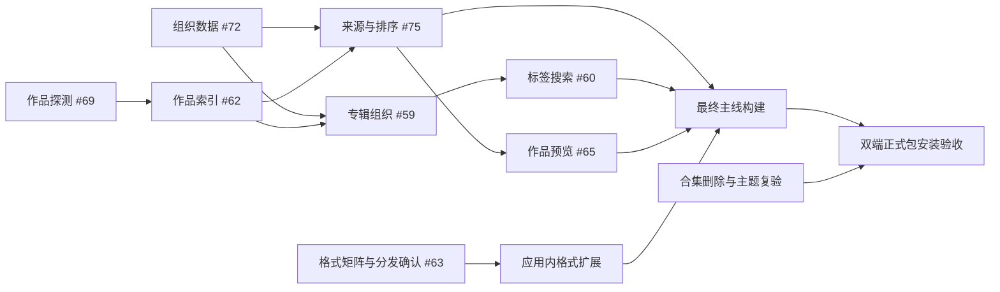

# iPreview 0.3.0 发布与验收登记

0.3.0 交付侧栏来源操作和文件排序、首版后续专辑组织与搜索、视频作品和常见格式扩展。各任务和合入进度汇总在 [0.3.0 里程碑](https://github.com/AMindFlow/iPreview/milestone/2)，承接[功能细节优化 #75](https://github.com/AMindFlow/iPreview/issues/75)和[首版 #1](https://github.com/AMindFlow/iPreview/issues/1)中本期指定条目。

| 工作包 | 规格与 Issue | 交付验收 |
| --- | --- | --- |
| 来源操作 | LIB-013，[#75](https://github.com/AMindFlow/iPreview/issues/75) | 双端从「源」右侧添加，右键与触摸板水平左滑显示重扫和删除。取消后目录与资料库记录保留。确认后只撤销该来源的索引、专辑组织和合集中的关联引用。核对其他来源、合集及磁盘原文件。 |
| 文件排序 | BRW-004，[#75](https://github.com/AMindFlow/iPreview/issues/75) | 图标、列表、画廊、选片及媒体预览可切换文件名、修改时间、大小和升降序。保留当前选择、预览方向键顺序及合集手工顺序。 |
| 专辑组织 | [ALB-002](../../specs/spike/virtual-albums.md#alb-002-旧版标签收藏评分与封面)，[#59](https://github.com/AMindFlow/iPreview/issues/59)，[数据契约 PR #72](https://github.com/AMindFlow/iPreview/pull/72) | 跨重启验证专辑收藏、未评／零分／半星、全库标签维护及自动、单图和拼图封面。验证非空旧库升级、离线回退和恢复。 |
| 分类与标签搜索 | [SRCH-003](../../specs/spike/search.md#srch-003-旧版分类结果与标签搜索)，[#60](https://github.com/AMindFlow/iPreview/issues/60) | 用两端相同样例核对组内匹配顺序、标签筛选、`#` 查询和键盘联想，覆盖当前／全局、精确／模糊及定位。 |
| 视频作品识别 | [LIB-006](../../specs/official/library.md#lib-006-两种视频作品结构)，[#62](https://github.com/AMindFlow/iPreview/issues/62)，[探测 PR #69](https://github.com/AMindFlow/iPreview/pull/69) | 同一批完整、简化目录从导入进入本地作品索引，覆盖重启、重扫和来源离线，核对视频、随目录提供的官方样张及附加写真集。外部样张提供方仍由 #62 单独确认。 |
| 作品分层预览 | [PRE-004](../../specs/official/preview.md#pre-004-视频作品的影碟与图册预览)，[#65](https://github.com/AMindFlow/iPreview/issues/65) | 从作品入口进入影碟／样张／各写真集。方向键选择，Space 进入，Esc 逐层返回。从媒体直接进入时在媒体层退出。 |
| 常见视频格式 | [PRE-006](../../specs/official/preview.md#pre-006-常见视频格式与本地回退)，[#63](https://github.com/AMindFlow/iPreview/issues/63) | 双端支持 MPEG-TS、MKV、WebM、AVI 的入库及后缀搜索。MKV、WebM 或 AVI 的系统解码失败时由 LibVLC 3.0.24 回退。验证包内运行时、许可和对应源码，以及离线播放、声音和同步。 |
| 本期复验 | [ALB-003](../../specs/official/virtual-albums.md#alb-003-合集删除)，[#61](https://github.com/AMindFlow/iPreview/issues/61)；[UI-007](../../specs/official/appearance.md#ui-007-主题选择与恢复)，[#64](https://github.com/AMindFlow/iPreview/issues/64) | 0.2.0 已交付，随本期最终安装包复验合集删除／取消、三档主题即时生效与重启恢复，并覆盖新组织和作品界面。 |

## 分工和依赖

来源操作与排序、专辑组织与搜索、视频作品使用独立 worktree。来源删除依赖组织索引的清理路径。双端按[正式版本交付流程](../../workflow/release.md)构建和验收，完成后在同一发布记录中归档最终提交、包校验、双端安装和人工核验入口。
