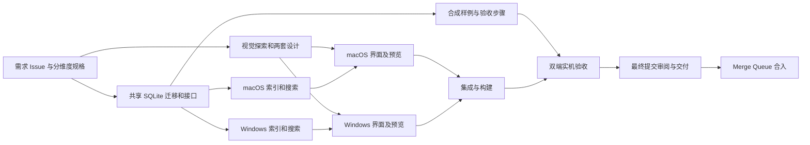
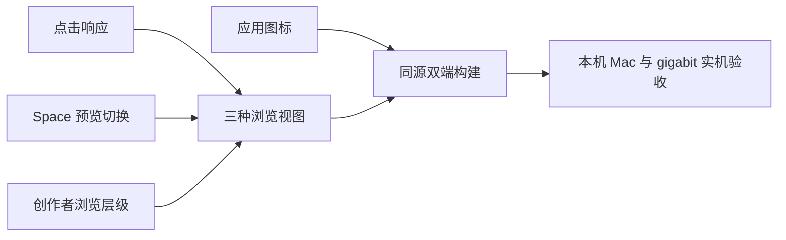

# 路线图

全部需求及后续待决项见[完整需求](requirements.md)。以下阶段划分用于决定实施和验收顺序。

| 阶段 | 状态 | 需求与可交付结果 |
| --- | --- | --- |
| 首版 | 已合入 | 交付 Apple Silicon macOS 和 Windows 11 x64 原生本地媒体库、目录导入与重扫、精确与模糊搜索、键盘图片和基础视频预览、跨来源虚拟专辑。范围见 [Issue #1](https://github.com/AMindFlow/iPreview/issues/1)，结果见[当前状态](current-state.md)。 |
| 首版体验补缺 | 已合入 | [PRE-007](../specs/official/preview.md#pre-007-space-打开和关闭预览) 再按 Space 关闭，[LIB-009](../specs/official/library.md#lib-009-多创作者来源的浏览层级) 先选择创作者，[BRW-001](../specs/official/browsing.md) 点击响应与 [BRW-002](../specs/official/browsing.md#brw-002-图标列表和画廊视图) 图标／列表／画廊视图，以及 [UI-001](../specs/official/appearance.md#ui-001-应用图标) 应用图标。 |
| 图片库深化 | 待实施 | 补齐 [LIB-003–005](../specs/spike/library.md#lib-003-旧版图库管理) 的旧目录管理、多工作区和旧库迁移，[ALB-002–003](../specs/spike/virtual-albums.md) 的旧版专辑工作流，[SRCH-002](../specs/spike/search.md) 标签搜索，[PRE-002–003](../specs/spike/preview.md#pre-002-常规图片预览与旧版兼容) 常规预览及漫画双页，以及[旧版主题选择](requirements.md#设计要求)。用合成旧库及相同样例验收迁移、隔离和浏览。 |
| 视频作品 | 待实施 | [LIB-006](../specs/spike/library.md#lib-006-两种视频作品结构) 两种作品目录、官方样张及写真集，[PRE-004](../specs/spike/preview.md#pre-004-视频作品的影碟与图册预览) 分层预览，[PRE-006](../specs/spike/preview.md#pre-006-常见视频格式扩展) 实测格式扩展，[META-001](../specs/spike/metadata.md#meta-001-提取和展示专辑文件元信息) 先覆盖视频读取。首批样张和写真集可用本地样例验收。 |
| 音频 | 后置，设计待审阅 | [LIB-007](../specs/spike/library.md#lib-007-音频组织) 常见格式及分组，[PRE-005](../specs/spike/preview.md#pre-005-音频专辑封面与-cd-机) 封面和 CD 机预览，[META-001](../specs/spike/metadata.md#meta-001-提取和展示专辑文件元信息) 扩至音频。设计通过后实施并在实机验证听音。 |
| iOS | 已登记，待排期 | [PLAT-001](../specs/spike/platforms.md#plat-001-ios-原生体验)，范围确定后独立构建和实机验收。 |
| 权限与分发决策 | 已登记，待确认 | [META-002](../specs/spike/metadata.md#meta-002-修改并写回实际文件) 实际文件写回，[LIB-008](../specs/spike/library.md#lib-008-旧版源文件操作) 旧版文件操作，[PLAT-002–003](../specs/spike/platforms.md#plat-002-旧版浏览器与局域网工作流) 旧版局域网入口与安装升级。作品样张的外部获取方式见 [LIB-006](../specs/spike/library.md#lib-006-两种视频作品结构)。确认范围后再排期。 |

## 后续工作拆分

- 首版体验补缺的五项分别追踪。选中卡顿可在现有图库独立复现和修复，三种布局共用选中与预览契约。创作者层级、图标设计与其余工作可并行。
- 图片库的多工作区数据契约先于迁移接入。迁移样例、漫画与常规预览的设计和实现可以并行。标签、封面、评分及虚拟专辑可按各自的数据及交互验收拆包，搜索联想依赖标签契约。
- 视频作品预览依赖作品索引契约。目录解析、预览设计、合成样例和格式底座验证可并行。元信息读取可独立交付，写回单独经过用户确认。
- 各独立工作包使用各自的 Issue、远程分支及 PR，标记前置依赖和验收范围。阶段发布验收汇总相关合入提交与产物。见 [GitHub Flow](../workflow/git.md)。

## 首版任务依赖

## 首版体验补缺任务依赖

